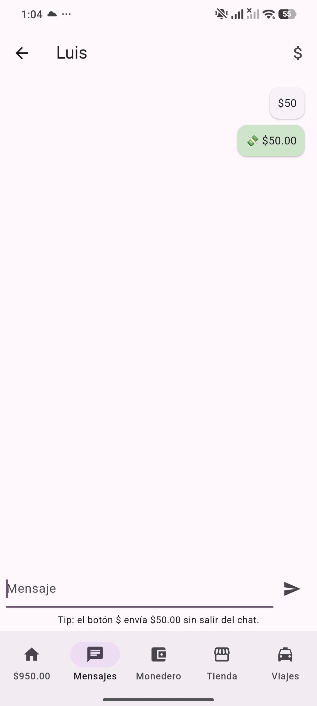
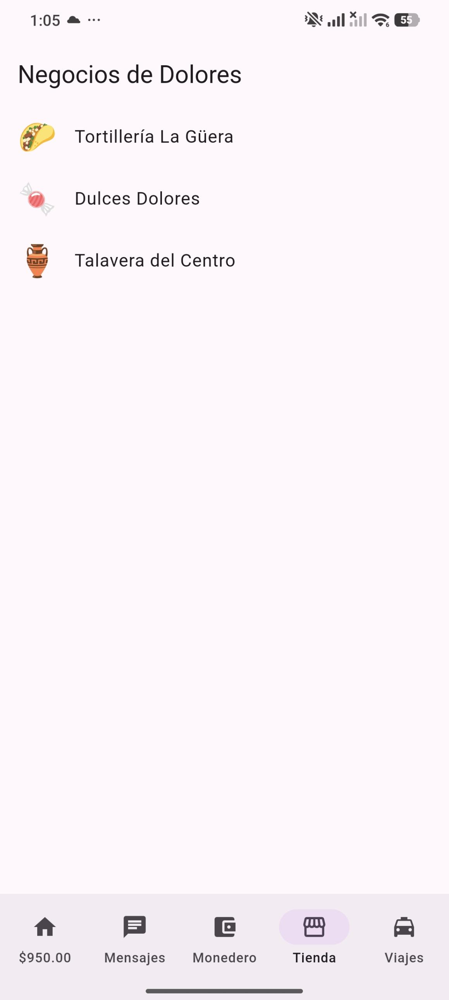
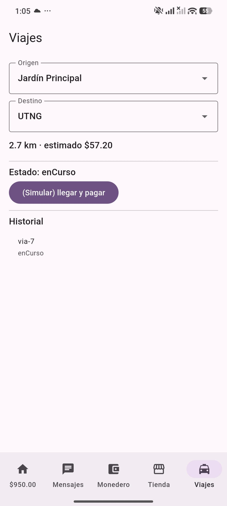
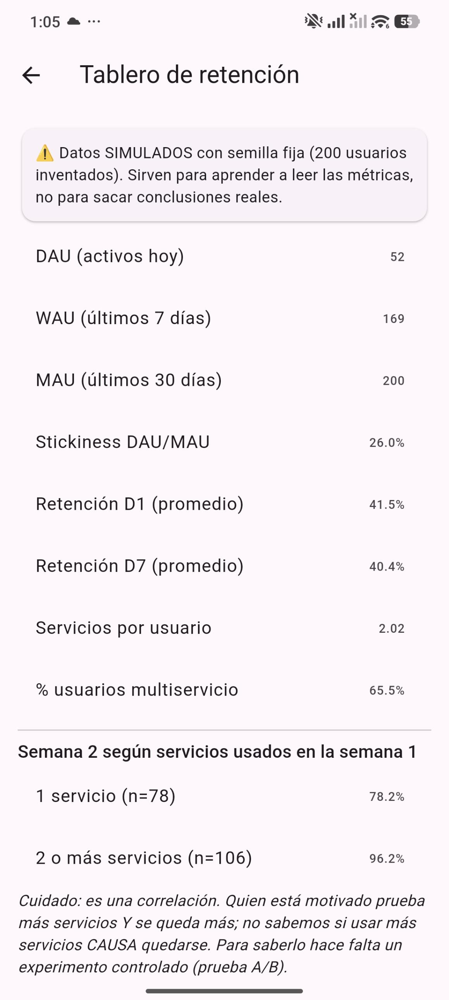
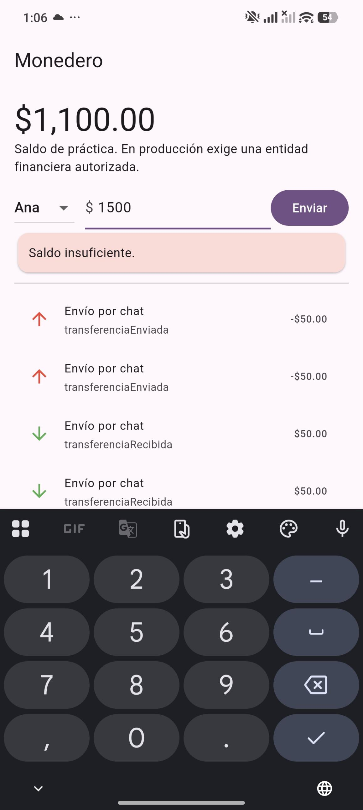

# Super Dolores — una SuperApp completa con TDD

Mensajería, monedero, comercio local y transporte **en una sola app** con una identidad. Construida con **TDD**
siguiendo el *Manual paso a paso con TDD — Super Dolores*: monedero como **libro de movimientos** (todo o nada,
idempotencia, límites, la suma del dinero no cambia), servicios coordinados por **eventos**, mini-apps con
**permisos mínimos** y **kill switch**, comercio con comisión del 5%, viajes con **máquina de estados** y tarifa
dinámica con tope, **lealtad** (puntos, niveles, bono por variedad, racha, canje), **analítica** (DAU/WAU/MAU,
stickiness, cohortes, retención) y notificaciones éticas.

> ⚠️ Simulación didáctica: el dinero es "de juguete" y los conductores son simulados.

---

## 📦 APK

| Archivo | Ruta |
|---|---|
| Lista para instalar | `apk/SuperDolores.apk` (16.6 MB) |
| Salida de Flutter | `build/app/outputs/flutter-apk/app-release.apk` |

```bash
flutter build apk --release --target-platform android-arm64
```

El APK es para teléfonos **arm64** (prácticamente todos los Android de los últimos años). Para instalar: copia el `.apk` al teléfono, ábrelo y acepta *instalar apps de origen desconocido*.

---

## 🏗️ Estructura

```text
lib/
├── dominio/        dinero · excepciones · eventos (bus) · monedero · mensajeria · comercio · transporte
│                   mini_app · contexto (permisos) · plataforma · lealtad · analitica · notificaciones · sugerencias
├── presentacion/   vm/ (inicio, monedero, chat, tienda, viajes, métricas) · pantallas/ (+ horóscopo de un tercero)
└── main.dart       la "concha": identidad + barra con las mini-apps ACTIVAS
test/  dominio_test · servicios_test · retencion_test · vms_test
```

---

## 🔴🟢🔵 Evidencia del ciclo TDD

### 1. 🔴 ROJO — las pruebas se escriben primero y fallan

Las pruebas de `test/` se escribieron **antes** que el código. Al correr `flutter test` con `lib/` todavía vacía, nada compila.

### 2. ❌ Error real atrapado por una prueba

Aquí la prueba que falló fue **la del manual**. En *"1 punto por cada $10 en compras y viajes"* espera:

```dart
..alEvento(compra(lunes, 5600))      // comercio
..alEvento(viaje(lunes, 8300));      // transporte
expect(l.puntos('u1'), 5 + 8);       // ❌ el manual olvidó su propia regla
```

Pero la regla 2 del mismo manual da **+50 por usar 2 servicios distintos en la semana** (comercio y transporte),
así que el motor —que está bien— dio 63.

**Corrección (en la prueba, no en el código):**

```dart
expect(l.puntos('u1'), 5 + 8 + 50);  // ✅ gasto + bono por 2 servicios distintos
```

Buen recordatorio de TDD: cuando una prueba falla hay que preguntarse **quién está mal, el código o la prueba**.

### 3. 🔵 REFACTOR — limpiar sin romper nada

Con las pruebas en verde se ordenó el código y `flutter analyze` quedó sin avisos.

### 4. 🟢 VERDE — las 104 pruebas pasan

Las 104 pruebas del proyecto pasan tras completar el ciclo de desarrollo y correcciones.

### 5. 📦 Compilación del APK

El APK de liberación se compila en modo `release` para `android-arm64`.

---

## ✅ Qué cubren las pruebas

| Grupo | Lo que se verifica |
|---|---|
| Dinero y fechas | formato de pesos, porcentaje con redondeo, la semana empieza en lunes, cruce de mes |
| Monedero | saldo = suma del libro, saldo insuficiente, montos inválidos, todo o nada, **la suma no cambia**, idempotencia, límite diario |
| Bus y mensajes | suscripción por tipo, un suscriptor que falla no tumba a los demás, chat con dinero dentro |
| Permisos | mini-app de tercero sin acceso, el chat paga pero no lee el saldo, API ligada al usuario, kill switch, viajes ajenos |
| Comercio y viajes | comisión 5%, invariante del dinero, inventario, Haversine 111.195 km, tarifa $83.00, tope 2.0, estados ilegales, cancelación |
| Retención | puntos, niveles, bono por variedad, racha, canje, DAU/WAU/MAU, cohortes D1/D7, correlación ≠ causa, notificaciones éticas, sugerencias |
| ViewModels | inicio, monedero, chat, tienda (idempotencia del carrito), viajes, métricas reproducibles |

```bash
flutter test
```

---

## 📱 Capturas de la app

> Tomadas en un teléfono físico con el APK instalado. *Guarda tus capturas en `capturas/` con estos nombres y aparecerán aquí automáticamente.*

| Inicio: saldo, puntos y sugerencia | Dinero dentro del chat | Tienda de Dolores |
|---|---|---|
|  |  |  |

| Viaje simulado | Tablero de retención | Error: tercero bloqueado |
|---|---|---|
|  |  |  |

| Error: saldo insuficiente | Kill switch: Viajes apagado |
|---|---|
|  |  |

### Qué probar en la app

| Caso | Qué hacer | Resultado esperado |
|---|---|---|
| Chat con dinero | Mensajes → Luis → botón $ | Burbuja verde "💸 $50.00" y Luis recibe aviso |
| Compra | Tienda → Tortillería → 2 kilos → Pagar | Pedido confirmado y puntos |
| Sin saldo | Talavera → Jarrón azul ($1,250) | "Saldo insuficiente." |
| Viaje | Pedir viaje → simular aceptar → iniciar → llegar | Cobro de la tarifa real |
| Tercero | Inicio → Mini-app de un tercero → leer saldo | "🛡️ Bloqueado: … no tiene permiso" |
| Kill switch | Inicio → "Simular falla: apagar Viajes" | Viajes desaparece de la barra |

---

## 🛠️ Cómo correr el proyecto

```bash
flutter pub get
```

```bash
flutter test
```

```bash
flutter run
```
